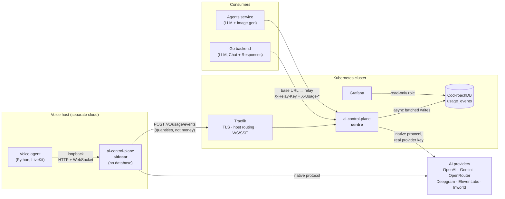
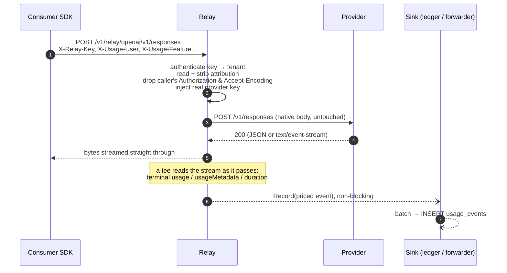

# ai-control-plane

**A self-hosted, multi-tenant AI cost meter.** It's a lean Go relay that sits
between your services and the AI providers they call (LLMs *and* real-time
audio), reads each provider's own usage numbers off the wire, prices every call,
and attributes it to a tenant, user, feature, module and unit of work.

> **Status: running in production.** It meters LLM, speech-to-text,
> text-to-speech and image-generation traffic for three services: a Go backend,
> a Go agents service, and a Python real-time voice agent built on LiveKit.
> Budgets and enforcement are designed but not built yet. See
> [What is built, what is planned](#what-is-built-what-is-planned).
>
> This repository is a cleaned-up public snapshot of an internal project. I
> removed company-specific deployment details and renamed consumers to generic
> roles. Everything else is the real code.

---

## Contents

1. [The problem](#the-problem)
2. [The idea: measure, don't estimate](#the-idea-measure-dont-estimate)
3. [What is built, what is planned](#what-is-built-what-is-planned)
4. [Architecture](#architecture)
5. [How the relay works](#how-the-relay-works)
6. [Sidecar mode: why a second copy of the relay exists](#sidecar-mode-why-a-second-copy-of-the-relay-exists)
7. [Consuming it](#consuming-it)
8. [Pricing](#pricing)
9. [Data model](#data-model)
10. [Security model](#security-model)
11. [Run it locally](#run-it-locally)
12. [Configuration](#configuration)
13. [Repository layout](#repository-layout)
14. [Design decisions](#design-decisions)
15. [Lessons learned in production](#lessons-learned-in-production)
16. [Roadmap](#roadmap)
17. [Further reading](#further-reading)

---

## The problem

A product that uses several AI providers ends up with AI spend spread across
many invoices, and none of them can say **who** the money was spent on:

- **Text LLMs**: OpenAI (Chat Completions *and* the newer Responses API),
  Google Gemini, OpenRouter.
- **Speech-to-text**: Deepgram (live WebSocket and pre-recorded), OpenAI
  Whisper / gpt-4o-transcribe, ElevenLabs Scribe.
- **Text-to-speech**: Inworld, ElevenLabs, Deepgram Aura.
- **Image generation**: Gemini image models, gpt-image-1.

Each provider bills in its own unit (tokens, characters, seconds of audio, image
tokens), reports usage in its own format, and invoices monthly per *account*.
None of that answers the questions a product team actually asks:

- *How much did **this user** cost us this month?*
- *Which **feature** is driving the bill: transcription or report generation?*
- *What does one **voice coaching session** cost end to end (STT + LLM + TTS)?*
- *Can we put a **budget** on a free-tier user?*

Before this project, the Go backend computed token usage on every call and threw
it away. The voice agent estimated per-session cost locally from SDK metrics,
which turned out to be wrong in the ways described below.

## The idea: measure, don't estimate

The core design choice is to put a **transparent relay** in the request path
instead of asking each service to report its own costs.

```
   service ──► provider            before: cost is whatever the service thinks it was
   service ──► relay ──► provider  after:  cost is read from the provider's own response
```

A relay sees the provider's own bytes: the `usage` object at the end of an
OpenAI stream, Gemini's `usageMetadata`, Deepgram's `metadata.duration`, and
the text actually sent to a TTS socket. That is the only way to *know* what a
call cost rather than *be told*. It also gives one choke point to hold the real
provider credentials, attribute spend, and (later) enforce budgets.

Three principles keep the relay small:

1. **Transparent relay, not a universal gateway.** Each provider's *native*
   protocol passes through untouched, and the relay only *observes* it. No
   translation into a unified schema. That is the LiteLLM/Portkey-scale
   problem this project deliberately avoids. It supports the providers that
   are actually used and adds new ones on demand.
2. **Metering is off the response path.** Extraction runs as a tee on the stream,
   pricing and persistence are asynchronous, and every metering failure degrades
   *metering*, never the call. A voice session must not stutter because a
   database is slow.
3. **Best-effort accuracy, honestly labelled.** Provider invoices stay the
   monthly ground truth. The system never treats an unknown price as free
   (`cost_known=false`), and it never mixes *measured* rows with *reported*
   ones (the `source` column).

## What is built, what is planned

| Capability | Status |
|---|---|
| HTTP + SSE relay for OpenAI, Gemini, OpenRouter, Deepgram, ElevenLabs, Inworld | ✅ Built |
| WebSocket relay with live usage metering (Deepgram STT/TTS, ElevenLabs, Inworld) | ✅ Built |
| Usage extraction: LLM tokens (incl. cached, reasoning), STT seconds, TTS characters, image tokens | ✅ Built |
| Pricing engine (`pricing.toml`): tokens, characters, audio seconds/minutes/hours, surcharges | ✅ Built |
| Attribution: tenant / user / feature / module / entity (e.g. a session) | ✅ Built |
| Caller authentication: per-consumer keys bound to a tenant, `shadow` → `enforce` rollout | ✅ Built |
| Append-only ledger in CockroachDB (async batched writer) | ✅ Built |
| Reported-usage ingest `POST /v1/usage/events` (idempotent) | ✅ Built |
| **Sidecar mode**: relay next to a latency-sensitive consumer, forwarding priced usage | ✅ Built |
| Zero-downtime deploys: `SO_REUSEPORT` + WebSocket draining | ✅ Built |
| Tenant-scoped spend API `GET /v1/usage/summary` | ✅ Built |
| Grafana dashboard over the ledger | ✅ Built |
| Embedded migrations (`server migrate`), run by CI before each deploy | ✅ Built |
| **Virtual keys**: short-lived, per-session credentials minted via `POST /v1/keys` | 🗺️ Planned |
| **Budgets & limits**: `CheckBudget`, limit CRUD, Redis/Dragonfly counters, `off → shadow → enforce` | 🗺️ Planned |
| Pre-aggregated `usage_rollups` table | 🗺️ Planned (covering indexes are enough so far) |
| Routing & fallback across providers | 🗺️ Planned |
| Exact-match response cache | 🗺️ Planned |
| Prometheus `/metrics` | 🗺️ Planned |
| Automatic `stream_options.include_usage` injection for Chat Completions streams | 🗺️ Planned (callers set it today) |

## Architecture



**One binary, three modes.** The usage sink is picked at boot from
configuration:

| Mode | Config | What it does with a metered call |
|---|---|---|
| **Centre** | `DB_URL` set | writes it to CockroachDB, serves the read API |
| **Sidecar** | `RELAY_REPORT_URL` set | forwards it to a centre over HTTPS |
| **Local** | neither | logs it (handy for development) |

Setting both is refused at boot. Neither choice is an obvious winner, and
silently picking one either strands the centre or abandons a database someone
configured on purpose.

**Zero new infrastructure.** It runs as one more Deployment behind the cluster's
existing Traefik, on the existing CockroachDB. Traefik does what it is good at
(TLS, host routing, WebSocket and SSE passthrough), and everything AI-aware
lives in this service.

## How the relay works

### The HTTP / SSE path



1. **Route.** `/v1/relay/<provider>/<upstream path>` selects a provider. The
   prefix is stripped, so the provider sees its own path.
2. **Authenticate.** The caller presents a relay key (`X-Relay-Key` header or
   `relay_key` query parameter). The key resolves to a **tenant**, which
   overrides any tenant the caller *claims*. See [Security](#security-model).
3. **Attribute.** `X-Usage-*` values are read and **stripped**. Nothing about
   attribution reaches the provider.
4. **Swap credentials.** The caller's `Authorization` / `x-goog-api-key` is
   dropped and the real key is injected in that provider's own scheme
   (`Bearer`, `x-goog-api-key`, `Token`, `xi-api-key`, `Basic`).
5. **Forward** with `httputil.ReverseProxy`, which flushes `text/event-stream`
   as it arrives, so streaming latency is unchanged.
6. **Extract.** A response wrapper tees the body through a per-provider
   **extractor**: a line scanner for SSE that never buffers the whole stream,
   and a bounded read for JSON. Extractors are selected **by path**, because one
   host bills several ways. On `api.openai.com`, `/v1/chat/completions` is LLM
   tokens, `/v1/audio/transcriptions` is STT seconds, and
   `/v1/images/generations` is image tokens.
7. **Price and record**, off the response path. `Sink.Record` never blocks. The
   ledger buffers events and drops (with a log line) rather than stall a
   response.

TTS is the one case metered from the **request**. The billable quantity is the
text submitted, so the body is read (bounded), restored for the upstream, and
the usage is held until the response shows the provider accepted the call.
Synthesis the provider rejected is never billed.

### The WebSocket path (real-time audio)

Real-time audio is where most of the money goes. A voice session streams
minutes of speech to Deepgram and text to a TTS provider, and none of it is an
HTTP request. `ReverseProxy` can forward a `101 Switching Protocols`, but it
just copies bytes and cannot read frames. So the relay handles WebSockets
itself:

```
 client ──frames──►┌──────────── relay ─────────────┐──frames──► provider
                   │ hijack both connections         │
                   │ parse RFC 6455 frame HEADERS    │
                   │ copy every byte through as-is   │
 client ◄─frames───│ hand payloads to a StreamMeter  │◄─frames── provider
                   └─────────────────────────────────┘
```

- **It observes the protocol and doesn't terminate it.** The relay does the
  upstream handshake for the caller, then copies frames through byte for byte
  while parsing just enough of each header to find the payload. Subprotocols,
  close codes, ping/pong and fragmentation stay the provider's business.
  Terminating the protocol would mean reimplementing every provider's
  expectations correctly forever.
- **A parser failure never drops a call.** If a frame can't be parsed, the
  relay falls back to **blind copying** for the rest of the conversation. The
  worst case becomes one lost metering row instead of a call cut off
  mid-sentence.
- **`permessage-deflate` is refused** in the handshake. Compressed frames are
  unreadable to the meter, and a relay that silently meters nothing is worse
  than one that uses a bit more bandwidth.
- **Per-provider stream meters** read the conversation: Deepgram's result
  durations, characters sent to ElevenLabs / Inworld / Aura, and so on.

### Attribution travels in one of three channels

Clients differ in what they can control, so the same names can travel in three
interchangeable ways:

| Channel | Example | Why it exists |
|---|---|---|
| **Headers** | `X-Relay-Key`, `X-Usage-User` | the default; nothing ends up in a URL log |
| **Query** | `?relay_key=…&usage_user=…` | most WebSocket clients can't set handshake headers |
| **Path segment** | `/v1/relay/deepgram/~<base64url(query)>/v1/listen` | some SDKs can't take a query either |

The path channel exists because of a real SDK. One LiveKit plugin builds its URL
as `f"{base_url}?{urlencode(opts)}"`, an unconditional `?`. A base URL that
already has a query becomes `…?a=b?model=nova-3`, and the upstream rejects it.
A path segment survives that concatenation, and every SDK relayed here treats
its base URL as an opaque prefix. The `~` marker can't collide with a real
upstream path, because those all start with an API version.

## Sidecar mode: why a second copy of the relay exists

Relaying is the point of the project, but relaying costs a network hop. For
most traffic that hop is negligible next to an LLM's own latency. In a
**real-time voice conversation** it isn't, because latency there is the
product.

In production the voice agent runs on a dedicated machine with a different
cloud provider than the Kubernetes cluster. Sending every audio frame across
that gap would put a cross-cloud round trip inside the conversation.

The bad fix would be to let the voice agent estimate its own cost. The fix used
here is to **move the relay instead**:

```
   voice agent ──loopback──► sidecar relay ──► providers        (audio path: no extra distance)
                                  │
                                  └──HTTPS, batched, async──► centre ──► CockroachDB
                                     (kilobytes per session, off the response path)
```

The sidecar is **the same binary** with `RELAY_REPORT_URL` set instead of
`DB_URL`. It still reads the provider's own bytes, so its rows stay labelled
`source=relayed` (measured). The voice agent's configuration differs by one
variable:

```
production   AI_RELAY_URL=http://127.0.0.1:8080        # sidecar, loopback
staging      AI_RELAY_URL=https://<centre-host>        # straight to the centre
```

Design rules that keep it honest:

- **Quantities cross the wire, never money.** The centre prices what it
  receives against its own `pricing.toml`, so there is exactly one rate table.
  Fixing a price means redeploying the centre, not a voice box someone has to
  SSH into. The one exception is a price the **provider itself** quoted for
  that call (ElevenLabs Scribe returns one). That figure is forwarded because
  no rate table can reproduce it.
- **The tenant comes from the key at both hops.** The centre books forwarded
  rows against the tenant bound to the sidecar's `RELAY_REPORT_KEY` and ignores
  any tenant in the payload.
- **Every failure is absorbed.** `Record` never blocks, the queue drops when
  full, and an unreachable centre is retried with bounded backoff and then
  given up on. The buffer lives in memory only. A sidecar killed mid-session
  loses seconds of metering, and that trade beats running a disk-spool
  durability system.
- **Idempotent ingest.** Each forwarded row carries a `client_event_id`, and the
  centre has a unique index on it, so a retry after a timeout can't double-bill.

### Zero-downtime deploys on plain Docker

The voice host has no orchestrator. Docker has no rolling update, and Compose
stops a container before starting its replacement, which leaves a gap on the
port. On a voice path, that gap is a failed session. The **service** makes
handover possible on its own:

1. **`SO_REUSEPORT`** (`LISTEN_REUSE_PORT=true`) lets the new container bind
   `127.0.0.1:8080` *while the old one is still serving*, so the port is never
   unbound.
2. **WebSocket draining.** `http.Server.Shutdown` waits for in-flight requests
   but explicitly **not** for hijacked connections, and every audio socket is
   hijacked. Without extra work, SIGTERM would cut every live conversation. So
   shutdown runs in a deliberate order: flag *draining* → stop accepting → wait
   up to `SHUTDOWN_GRACE` for live sockets to end → *then* flush the usage sink,
   because those sockets were still producing usage.
3. **A private health address per instance** (`HEALTH_ADDR`). On a shared port,
   a health check might be answered by either instance, so it can't tell you
   whether the *new* one is serving. While draining, an instance answers `503
   draining (2 websockets open)`, which is how you watch a deploy finish.

[`deploy/sidecar/deploy.sh`](deploy/sidecar/deploy.sh) runs this sequence. In
testing it handled 500/500 polls during a handover without a single refused
connection.

## Consuming it

Integrating a service takes three steps:

1. Point the provider SDK's **base URL** at `https://<relay>/v1/relay/<provider>`.
2. Send a **relay key** (`X-Relay-Key`). The SDK still needs *some* API key
   value, but the relay discards it.
3. Add **attribution** with the `X-Usage-*` headers. All of them are optional
   and all are stripped before the provider sees the request.

| Header | Meaning |
|---|---|
| `X-Usage-User` | the end user the call is on behalf of (opaque string) |
| `X-Usage-Module` | which service/module made the call (`dictionary`, `voice`) |
| `X-Usage-Feature` | finer label within the module (`term_generation`) |
| `X-Usage-Entity-Type` / `X-Usage-Entity-Id` | the unit of work to sum calls under, e.g. (`session`, `abc123`) |
| `X-Usage-Model` | model id, **only** when the response won't name one (Whisper `verbose_json`, image generation) |
| `X-Usage-Request` | the request's parameters as JSON, minus binary payloads ([why](docs/metering-contract.md)) |
| `X-Usage-Tenant` | only honoured when auth is disabled. Otherwise the key decides the tenant |

Identity is **opaque**. The relay stores strings and never imports a consumer's
types. One service, one attribution contract, any language.

### OpenAI (Python)

```python
import os
from openai import OpenAI

client = OpenAI(
    base_url="https://relay.example.com/v1/relay/openai/v1",
    api_key="unused",  # the relay injects the real key
    default_headers={
        "X-Relay-Key": os.environ["AI_RELAY_KEY"],
        "X-Usage-Module": "dictionary",
    },
)

client.responses.create(
    model="gpt-5-mini",
    input="Define 'ephemeral'.",
    extra_headers={"X-Usage-User": user_id, "X-Usage-Feature": "term_generation"},
)
```

For **Chat Completions streaming**, set
`stream_options={"include_usage": True}`. OpenAI only puts usage in the final
chunk when you ask for it. The Responses API always reports usage.

### Gemini (Go, `google.golang.org/genai`)

```go
client, _ := genai.NewClient(ctx, &genai.ClientConfig{
    Backend: genai.BackendGeminiAPI,
    APIKey:  "unused",
    HTTPOptions: genai.HTTPOptions{
        BaseURL: relayURL + "/v1/relay/gemini", // the SDK appends /v1beta/models/…
        Headers: http.Header{
            "X-Relay-Key":     {relayKey},
            "X-Usage-Module":  {"agents"},
            "X-Usage-User":    {userID},
        },
    },
})
```

In the Go backend this lives in an `http.RoundTripper` that stamps `X-Usage-*`
from the request `context.Context`. Existing call sites stay unchanged, and an
unset `AI_RELAY_URL` keeps the old direct-to-provider behaviour, so rollout is
opt-in per environment.

### Deepgram live transcription (WebSocket)

WebSocket clients that can't set headers put the same values in the URL:

```
wss://relay.example.com/v1/relay/deepgram/v1/listen?model=nova-3&relay_key=…&usage_user=u-42&usage_entity_type=session&usage_entity_id=s-9
```

or, for SDKs that append their own `?…`, as a path segment:

```python
segment = "~" + base64.urlsafe_b64encode(urlencode({
    "relay_key": key, "usage_user": "u-42",
    "usage_entity_type": "session", "usage_entity_id": "s-9",
}).encode()).rstrip(b"=").decode()

base_url = f"wss://relay.example.com/v1/relay/deepgram/{segment}"
```

> **Inworld** is the exception to the `/v1/relay/<provider>` prefix. Its SDK
> joins paths with a leading slash, which throws away any base-URL path, so the
> relay serves Inworld's own `/tts/…` paths at its root.

### Reporting usage that can't be relayed

Some spend never passes through the relay, for example a webhook-delivered
async transcription. For those, a consumer can **report quantities** (never
dollars):

```bash
curl -X POST https://relay.example.com/v1/usage/events \
  -H "X-Relay-Key: $AI_RELAY_KEY" -H "Content-Type: application/json" \
  -d '{"events":[{
        "client_event_id":"evt-1",
        "user":"user-42","feature":"live_transcription","module":"voice",
        "provider":"deepgram","model":"nova-3","modality":"stt",
        "audio_seconds":95.5,"occurred_at":"2026-11-13T12:01:00Z"}]}'
# → {"accepted":1,"rejected":0}
```

The centre prices the event. Reported rows are stored as `source=reported`, so
they can't be confused with measured rows when reconciling against an invoice.
A batch is never all-or-nothing: one malformed row is rejected, and the rest
are kept.

### Reading spend

```bash
curl "https://relay.example.com/v1/usage/summary?group_by=modality&from=2026-11-01T00:00:00Z" \
  -H "X-Relay-Key: $AI_RELAY_KEY"
```

```json
{
  "tenant": "demo",
  "group_by": "modality",
  "total":  { "calls": 2, "unpriced_calls": 0, "input_tokens": 1200, "output_tokens": 300, "cost_usd": 0.00805 },
  "groups": [
    { "key": "stt", "calls": 1, "cost_usd": 0.00769 },
    { "key": "llm", "calls": 1, "input_tokens": 1200, "output_tokens": 300, "cost_usd": 0.00036 }
  ]
}
```

`group_by` ∈ `user | feature | module | model | provider | modality`, with an
optional `user=` filter. **The key decides the tenant.** There is no way to ask
for another tenant's numbers. `unpriced_calls` is always reported, because a
non-zero count means `cost_usd` is an underestimate.

The full consumer contract, including `X-Usage-Request` billing hints and what
is measured vs. inferred per provider, is in
[`docs/metering-contract.md`](docs/metering-contract.md).

## Pricing

[`pricing.toml`](pricing.toml) is baked into the image and can be overridden
with `PRICING_PATH`. Each model is priced in the unit its provider bills:

```toml
[models."gpt-5.6-terra"]          # LLM: USD per million tokens
input_per_mtok        = 2.00
cached_input_per_mtok = 0.20
output_per_mtok       = 12.00

[models."nova-3"]                 # STT: whichever unit the provider publishes
per_audio_minute = 0.0077         # (per_audio_second / _minute / _hour, normalised on load)

[models."inworld-tts-2-flash"]    # TTS
per_1k_characters = 0.005
```

```
cost = (input − cached_input) · input_rate
     +  cached_input           · cached_input_rate
     +  output                 · output_rate                      (LLM, image)
cost = audio_seconds · per_second · surcharge_multiplier          (STT)
cost = characters    · per_character                              (TTS)
```

Rules:

- **Unpriced is not free.** A model with no entry is recorded as `cost_usd=0,
  cost_known=false`, with a warning logged and the row flagged in Grafana.
- **Version-pinned model ids.** Dated snapshots in responses are normalised
  before lookup, but an alias like `-latest` is never priced. A provider moving
  an alias must not silently change what you pay.
- **Surcharges are kept separately** (`surcharge_multiplier`), for example
  ElevenLabs' +20% for keyterms. Quantities then stay the real measured values,
  and a row can be re-priced later.
- **A provider-quoted price wins** over the table when the provider gives one.

## Data model

One append-only table is the source of truth: **`usage_events`**.

| Column | Notes |
|---|---|
| `id` | UUID |
| `tenant` | from the authenticated key |
| `subject_user`, `feature`, `module` | opaque attribution strings |
| `entity_type`, `entity_id` | the unit of work calls are summed under (`session`, `channel`, …) |
| `provider`, `model`, `modality`, `unit` | `modality ∈ {llm, stt, tts, image}`, `unit ∈ {tokens, seconds, characters}` |
| `input_tokens`, `cached_input_tokens`, `output_tokens` | LLM / image |
| `audio_seconds`, `characters` | audio |
| `cost_usd`, `cost_known` | computed at ingest. `cost_known=false` means *unknown*, not free |
| `source` | `relayed` (read from provider bytes) or `reported` (asserted by a consumer) |
| `client_event_id` | idempotency key for reported/forwarded rows (unique) |
| `metadata` | JSONB: billing hints the caller declared, kept for audit |
| `occurred_at` | when the usage happened, not when it was reported |

Covering indexes on `(tenant, occurred_at)` and `(tenant, subject_user,
occurred_at)` keep the summary API and the dashboard fast without a rollup
table so far. Rollups and a columnar store are deliberately deferred until
volume proves they're needed.

## Security model

The relay holds every provider's real API key. Exposed without auth, it would
be an **open proxy to paid AI accounts**. So:

- **Callers authenticate with relay keys**: `RELAY_AUTH_KEYS="key:tenant,…"`.
  Comparison is constant-time. Each key is **bound to a tenant**, and the
  bound tenant overrides any tenant the caller claims. A leaked key can only
  ever book spend against its own tenant.
- **The relay's credential travels in its own channel** (`X-Relay-Key`), never
  in the provider's credential slot. Providers disagree about where a key
  lives, and borrowing their slot would need custom logic per provider, plus a
  scheme that might not work for the next provider at all.
- **Everything the relay understands is stripped** before forwarding: the relay
  key, `X-Usage-*`, and the caller's own provider credentials.
- **`shadow` mode for rollout.** Turning auth on is dangerous in a way that's
  easy to miss. The relay sits *in the request path*, so a consumer that hasn't
  been redeployed with a key doesn't just go unmetered; its AI calls fail. In
  shadow mode, keys are checked and every unauthenticated caller is logged by
  name, but nobody is rejected. You roll keys out, wait for the warnings to
  stop, and then switch to `enforce` (the default). This order exists because
  of a real incident in staging.
- **The read API fails closed.** `/v1/usage/summary` refuses to serve at all
  without a keyring, rather than defaulting to "everyone can read everything".
- **Errors are deliberately terse.** "No credential" and "wrong credential" look
  the same to the caller.

## Run it locally

Requirements: Go 1.26+, Docker.

```bash
make up         # single-node CockroachDB in Docker, creates the database
make migrate    # applies the embedded migrations (server migrate up)

export RELAY_AUTH_KEYS="dev-key:demo"
export OPENAI_API_KEY=sk-...        # any provider keys you have; others are refused, not forwarded empty
make run        # relay on :8899, ledger → local CockroachDB
```

Then:

```bash
curl localhost:8899/healthz                                    # ok

# a real relayed call (needs OPENAI_API_KEY)
curl localhost:8899/v1/relay/openai/v1/responses \
  -H "X-Relay-Key: dev-key" -H "X-Usage-User: user-42" -H "Content-Type: application/json" \
  -d '{"model":"gpt-5-mini","input":"Say hi"}'

# or report usage without any provider key at all
curl -X POST localhost:8899/v1/usage/events -H "X-Relay-Key: dev-key" \
  -d '{"events":[{"client_event_id":"e1","user":"user-42","provider":"openai","model":"gpt-4o-mini","modality":"llm","input_tokens":1200,"output_tokens":300,"occurred_at":"2026-11-13T12:00:00Z"}]}'

curl "localhost:8899/v1/usage/summary?group_by=user" -H "X-Relay-Key: dev-key"
make usage      # tail the ledger directly
```

> **Verify metering with a real SDK, not `curl`.** `curl` doesn't request gzip
> and doesn't reuse keep-alive connections. Two of the silent-metering bugs
> described [below](#lessons-learned-in-production) were invisible to `curl`
> and showed up immediately with the official SDKs.

Other targets: `make test`, `make build-linux` (cross-compiles to catch
platform-specific code such as `SO_REUSEPORT`), `make bobgen`, `make down`.

## Configuration

| Variable | Default | Mode | Purpose |
|---|---|---|---|
| `LISTEN_ADDR` | `:8080` | all | main listener. Sidecars **must** bind `127.0.0.1:…` |
| `PRICING_PATH` | `pricing.toml` | all | rate table |
| `RELAY_AUTH_KEYS` | — | all | `key:tenant,key:tenant`. Empty = unauthenticated (logged loudly) |
| `RELAY_AUTH_MODE` | `enforce` | all | `enforce` or `shadow` |
| `OPENAI_API_KEY`, `GOOGLE_API_KEY`, `OPENROUTER_API_KEY`, `DEEPGRAM_API_KEY`, `ELEVENLABS_API_KEY`, `INWORLD_API_KEY` | — | all | real provider credentials. An absent key means that provider refuses requests |
| `DB_URL` | — | centre | Postgres/CockroachDB DSN. Or `DB_HOST`/`DB_PORT`/`DB_USER`/`DB_PASSWORD`/`DB_NAME`/`DB_SSLMODE` |
| `RELAY_REPORT_URL`, `RELAY_REPORT_KEY` | — | sidecar | centre to forward to, and the key to present there |
| `SHUTDOWN_GRACE` | `30s` | all | how long shutdown waits for live WebSockets |
| `LISTEN_REUSE_PORT` | `false` | sidecar | `SO_REUSEPORT` for zero-downtime handover |
| `HEALTH_ADDR` | — | sidecar | private per-instance health listener |

In Kubernetes, secrets arrive as mounted `.env` bundles
(`internal/config/secrets.go`), and real environment variables take precedence.

## Repository layout

```
cmd/server/            entrypoint: sink selection, routes, ordered graceful shutdown, `migrate` subcommand
internal/relay/        the relay: per-provider ReverseProxy, auth, attribution channels,
                       WebSocket hijack + RFC 6455 frame pump, socket draining, rewindable bodies
internal/relay/extract/  usage extractors: SSE/JSON LLM, image, STT/TTS (HTTP and stream meters), billing hints
internal/pricing/      pricing.toml loader + cost math
internal/ledger/       relay.Sink → CockroachDB (async, batched, failure-collapsing logs)
internal/forward/      relay.Sink → HTTP forwarder (sidecar mode)
internal/usage/        POST /v1/usage/events ingest, GET /v1/usage/summary
internal/infra/        pgx pool, schema-version check, SO_REUSEPORT listener, generated Bob models
db/migrations/         golang-migrate SQL, one operation per file, embedded in the binary
deploy/sidecar/        zero-downtime Docker deploy script + env template for the sidecar
deploy/grafana/        dashboard JSON + read-only DB role
docs/                  architecture deep dive, metering contract, image-gen notes, build-vs-buy survey
```

## Design decisions

**Build vs. buy.** I compared eleven gateways and observability products
([`docs/landscape.md`](docs/landscape.md)). Each one failed at least one of two
hard requirements:

1. **Meter *our own* audio provider accounts over native WebSocket, per user.**
   No product did this. The closest option routed Deepgram to *its own* hosted
   instance, which means a new billing relationship rather than our account.
2. **Add no heavy infrastructure.** The products with a real per-user dashboard
   bring ClickHouse + Kafka with them.

What actually got built is small: usage extraction, a pricing engine, an
attribution contract and an audio WebSocket relay. Everything else is existing
infrastructure plus ideas borrowed from the field: Helicone's limit matrix,
Cloudflare's metadata-scoped spend limits, and LiteLLM's public price map as a
sync source.

**Go with the standard library.** The service uses `net/http` and `ServeMux`
with Go 1.22 routing, and no framework. A relay isn't RPC-shaped, and
`httputil.ReverseProxy` gives streaming for free.

**Bob on CockroachDB, generated from Postgres.** The ORM is Bob (typed query
DSL, no raw SQL in repositories). Bob's generator can't introspect CockroachDB
(`max(string[])` is rejected). The fix is to keep migrations in **portable DDL**,
generate the models from a throwaway Postgres (`make bobgen`), and run them on
CockroachDB. The bob library is pinned to the generator version.

**Migrations ship inside the binary.** `server migrate` runs in CI before each
deploy, with the same secrets as the service. At boot, the service compares the
schema version against what it expects and logs a loud error on mismatch. A
schema that lags behind the binary doesn't crash anything; it silently drops
every usage event, so the check has to say so out loud.

**Tenant scoping in the app, not Postgres RLS.** With a handful of tenants, RLS
would add complexity and CockroachDB-specific risk for little benefit.

## Lessons learned in production

Each of these bugs let the caller get a perfectly valid response **while
metering recorded nothing (or $0)**. That is the worst failure mode a cost
system can have, and each fix is pinned by a test.

- **Gzip.** Every real SDK sends `Accept-Encoding: gzip`. If the relay forwarded
  it, the provider gzipped the response, Go's transport didn't decompress it
  (Go only does that for a header *it* added), and the extractor tried to parse
  gzip as JSON. The relay now deletes `Accept-Encoding`, so its own transport
  owns compression. `curl` never sends that header, which is how the bug stayed
  hidden. (`TestMetersGzippedResponse`)
- **Responses API vs. Chat Completions.** The two APIs name the same counts
  differently (`input_tokens` vs `prompt_tokens`). Unmarshalling a Responses
  payload into the Chat struct *succeeds* with every field zero, which records
  a phantom free call. Counts are now read through pointers, so an unrecognised
  shape is **rejected rather than zeroed**.
- **Non-rewindable request bodies.** `ReverseProxy` builds its outbound request
  from the server request, whose `GetBody` is always nil, so Go can't retry it.
  Deepgram's long pre-recorded calls exposed both failure modes: an HTTP/2
  `GOAWAY` mid-request, and on HTTP/1.1 a stale keep-alive connection. Forcing
  HTTP/1.1 made it about 100× worse. Setting `GetBody` fixed the actual cause,
  and Go's transport now retries both transparently.
- **WebSockets ignored by graceful shutdown.** `Server.Shutdown` doesn't wait
  for hijacked connections, so every deploy cut every live conversation. The
  fix is the ordered drain [above](#zero-downtime-deploys-on-plain-docker).
- **Context dropped in consumer code.** A service that calls the AI with
  `context.Background()`, or keeps a long-lived context in a struct, silently
  loses per-user attribution. When onboarding a new module, check for this
  first.
- **The client-side estimate was wrong.** The voice agent's local cost
  calculator and the relay disagreed on exactly the sessions where TTS failed
  over to a backup voice. The estimate priced a voice that never spoke, and
  that's why principle #5 is *cost comes from what flows through the relay*.

## Roadmap

- **Phase 1 — LLM metering.** ✅ Relay, extraction, ledger, Go backend wired in.
- **Phase 2 — Audio over WebSocket.** ✅ Deepgram, ElevenLabs, Inworld meters,
  the sidecar, and the voice agent wired in.
- **Phase 2b — Image generation.** ✅ Token-billed image models with their own
  modality ([notes](docs/image-generation.md)).
- **Phase 3 — Dashboard.** ✅ Grafana over the ledger, plus the tenant-scoped
  summary API for anything customer-facing.
- **Phase 4 — Limits.** 🗺️ A limit matrix `(tenant, subject, window, unit,
  threshold, mode)` budgeted in **USD** (tokens, characters and seconds aren't
  comparable), with Redis-wire counters on the hot path, and rolled out `off →
  shadow → enforce`. Voice is gated at **session start** in the app: refusing to
  *start* an over-budget call is better than cutting one off mid-sentence.
  Counters fail **open** on a cache outage, but events keep being written.
- **Phase 4b — Virtual keys.** 🗺️ Short-lived credentials minted per unit of
  work, encoding `(tenant, user, feature, module, entity)`. One credential then
  covers identity, upstream auth, budget subject and routing selector, and
  revoking it ends a session's access immediately. The path-segment channel is
  the seam: it would carry an opaque minted id the relay *resolves* instead of
  values it decodes, without any client changing where it puts the token.
- **Phase 5 — Routing, fallback, caching.** 🗺️ Rule-based LLM failover
  (straightforward before the first token, resend-and-discard mid-stream), and
  an exact-match cache for deterministic `temperature=0` calls. Mid-session
  WebSocket audio failover is deliberately *not* promised.
- **Observability.** 🗺️ Prometheus `/metrics`.

## Further reading

- [`docs/architecture.md`](docs/architecture.md): internals, request lifecycle,
  shutdown ordering, the database layer
- [`docs/metering-contract.md`](docs/metering-contract.md): the consumer
  contract, billing hints, measured vs. inferred quantities per provider
- [`docs/image-generation.md`](docs/image-generation.md): how image spend is
  metered
- [`docs/landscape.md`](docs/landscape.md): the build-vs-buy survey
- [`deploy/sidecar/README.md`](deploy/sidecar/README.md): running a sidecar
- [`deploy/grafana/README.md`](deploy/grafana/README.md): the dashboard

## License

**All rights reserved; view-only.** This code is published so it can be read
and evaluated. It may not be used, copied, modified or redistributed. See
[`LICENSE`](LICENSE).
